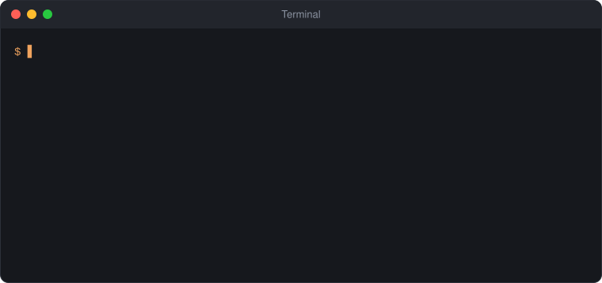
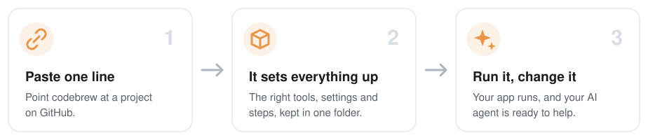

<p align="center">
  <a href="https://github.com/colbymchenry/codebrew">
    
  </a>
</p>

<h1 align="center">codebrew</h1>

<p align="center">
  <b>Run someone else's app on your Mac with one command.</b><br>
  Like a one-click installer, but for code projects. codebrew installs what a project needs, sets it up, and gets your AI coding agent ready to help.
</p>

<p align="center">
  <a href="https://github.com/colbymchenry/codebrew/releases/latest"></a>
  <a href="#install"></a>
  <a href="#safety-and-privacy"></a>
  <a href="#faq"></a>
</p>

<p align="center">
  <a href="#install"><b>Install</b></a> ·
  <a href="#quick-start">Quick start</a> ·
  <a href="#what-you-can-do">What you can do</a> ·
  <a href="#for-project-owners">For project owners</a> ·
  <a href="#faq">FAQ</a>
</p>

<p align="center">
  <a href="#quick-start"></a><br>
  <sub>Get a project, run it, change it with your AI agent, and send the change back. That's the whole loop.</sub>
</p>

## Which one are you?

| If… | Start here |
|---|---|
| **Someone sent you a project.** You want to run it and try changes, maybe with an AI agent, without a developer walking you through setup. | [Install](#install), then follow the [Quick start](#quick-start). |
| **You own a project.** You want other people to run it with one command, without a setup call and without sending passwords over chat. | [Install](#install), then read [For project owners](#for-project-owners). |

## How it works

<p align="center">
  <a href="#install">
    <picture>
      <source media="(prefers-color-scheme: dark)" srcset="assets/how-it-works-dark.svg">
      <source media="(prefers-color-scheme: light)" srcset="assets/how-it-works-light.svg">
      
    </picture>
  </a>
</p>

## Install

Open Terminal (press <kbd>⌘</kbd> <kbd>Space</kbd>, type <kbd>Terminal</kbd>, press <kbd>Return</kbd>). Paste this line and press <kbd>Return</kbd>:

```sh
curl -fsSL https://github.com/colbymchenry/codebrew/releases/latest/download/install.sh | sh
```

Then open a new Terminal window, and you're ready.

> [!NOTE]
> codebrew never asks for your password or for admin rights. Everything it installs lives in one folder, `~/.codebrew`. You can remove all of it at any time with `codebrew self uninstall`.

<details>
<summary>What the installer does, and how to update</summary>

- Downloads the build for your Mac (Apple silicon or Intel), signed and notarized by Apple.
- Checks it against the release's published checksums.
- Puts it in `~/.codebrew/bin` and adds one line to `~/.zprofile` so Terminal can find it.

To update later, run `codebrew self update`. For iOS apps you also need Xcode, free from the Mac App Store; codebrew tells you if anything else is missing.

</details>

## Quick start

For when someone has shared a project with you. You need a GitHub account that can see it.

1. **Get the project.**

   ```sh
   codebrew clone owner/repo
   ```

   Use the name the owner sent you, like `acme/storefront`. codebrew signs you in to GitHub if the project is private, shows you what it will install and run, and asks you to approve. Then it sets everything up. The first time can take a few minutes.

2. **Run the app.** `codebrew tasks` lists what the project can do. For example, `codebrew run web:dev` starts a web app and prints the address to open, and `codebrew run mobile:ios` opens an iOS app in the simulator.

3. **Ask your AI agent for changes.** `codebrew start` opens Claude Code in the project, already briefed on its tools and tasks. Describe what you want in your own words.

4. **Send your changes back.** `codebrew ship --message "Add a dark mode"` saves your work to a new branch, checks that no secret settings slipped in, and opens a pull request for the owner to review.

If something goes wrong, the message says what happened and which command to run next. `codebrew doctor` checks your whole setup, and `codebrew repair` hands the last problem to your agent to fix.

## What you can do

- **Run almost any app.** Web apps (Next.js, Vite and more), Electron desktop apps, native iOS and Android apps, React Native and Expo. Anything else works with a few lines of setup.
- **Keep your Mac clean.** No global installs and no version clashes. Each project gets the exact tools it was built with, kept inside `~/.codebrew`.
- **Get the right settings, safely.** Test accounts and server addresses arrive encrypted, only for the environments you're allowed, such as dev and UAT. Add `--env uat` to any command to switch. Owners can keep production out of reach entirely.
- **Work with an AI agent that knows the project.** Claude Code or Codex starts with the project's tools ready and a description of every task it can run.
- **Hand changes back without learning git.** One command commits, pushes and opens the pull request.
- **Never get stuck on a cryptic error.** Every failure comes with a plain sentence and the next command to try.

## For project owners

Set a project up once, and anyone you invite gets a working copy with one command.

1. **Describe the project.** In your repository, run `codebrew init`. It detects your apps, the tools they need and your `.env` files, and drafts `codebrew.toml`. Review it, then run `codebrew lock` to pin exact versions.
2. **Add each environment's settings.** `codebrew env import dev .env.development`, or pull them from Vercel or EAS with `codebrew env import uat --from vercel`. Values are encrypted in the repository; only their names are readable.
3. **Commit and share.** Commit `codebrew.toml`, `codebrew.lock` and the `.codebrew` folder, then send collaborators the repository name.
4. **Approve access.** When someone asks to read an environment, codebrew opens an issue on your repository. Approve it with `codebrew access grant <issue>`, and remove people with `codebrew access revoke`.

`codebrew verify` sets the project up from nothing in a fresh home folder, just as a new collaborator's Mac would, and builds each app. `codebrew doctor --owner` checks the repository settings that keep this safe.

<details>
<summary>What a <code>codebrew.toml</code> looks like</summary>

```toml
schema = 1
name = "storefront"

[tools]
node = "24"

[apps.web]
kit = "web"

[environments.dev]
default = true
access = ["collaborator", "ci"]

[environments.prod]
access = ["ci"]   # only your CI can read production
local = false     # and it never reaches a laptop
```

</details>

## Safety and privacy

- **Nothing system-wide.** No admin password and no `sudo`. Files go in `~/.codebrew` and the project's folder. The only exceptions are files that Apple's tools or the project's own app write, such as Xcode's simulators.
- **You approve what runs.** Before setup, codebrew lists what the project will install and run. Approving means you trust the project's owner, so only approve projects from people you trust.
- **Settings stay encrypted.** Environment values are encrypted to the people allowed to read them. Owners can keep production off laptops entirely.
- **No tracking.** codebrew has no server and collects no data.
- **Verified downloads.** Releases are signed and notarized by Apple, and the installer checks every download against its checksum.

<details>
<summary>What codebrew does not protect against</summary>

- **A harmful agent.** The agent works in a sandbox that stops accidents, but anything it changes in the project's scripts runs when you run those scripts. Treat the agent as acting with your authority inside the project.
- **A harmful collaborator.** Anyone who can read an environment can copy it. Give collaborators test credentials only; `codebrew env audit` warns when values are reused.
- **A harmful project.** The approval step shows you what a project will run. It is informed trust, not a sandbox for setup.

</details>

## FAQ

**Do I need to be a developer?**
No. If you can paste a line into Terminal, you can use codebrew. Your AI agent writes the code.

**Does it work on Windows or Linux?**
Not yet. codebrew runs on macOS, on Apple silicon and Intel Macs.

**Which AI agents does it work with?**
Claude Code and Codex. You use your own account for the agent.

**Is it safe to run someone else's project?**
It's as safe as the person who sent it. Projects run their own setup scripts, so codebrew shows you what will run before anything happens, and keeps everything it installs in its own folder.

**How do I remove it?**
Run `codebrew self uninstall`. It removes the line it added to `~/.zprofile` and, when you confirm, the `~/.codebrew` folder. Your project folders stay where they are.

**Something broke. What now?**
Run `codebrew doctor`. It says what's wrong and often how to fix it. `codebrew repair` asks your agent to fix the last failure. Still stuck? [Open an issue](https://github.com/colbymchenry/codebrew/issues).

## Why not just…

| | A setup guide | Docker | Version managers | **codebrew** |
|---|:---:|:---:|:---:|:---:|
| From a link to a running app in one command | — | — | — | ✓ |
| Works for iOS apps | ✓ | — | ✓ | ✓ |
| Leaves the rest of your Mac untouched | — | ✓ | ✓ | ✓ |
| Shares dev settings without passing secrets around | — | — | — | ✓ |
| Starts an AI agent that knows the project | — | — | — | ✓ |

<br>

<p align="center">
  <sub>Found a problem or have an idea? <a href="https://github.com/colbymchenry/codebrew/issues">Open an issue</a>.</sub>
</p>
